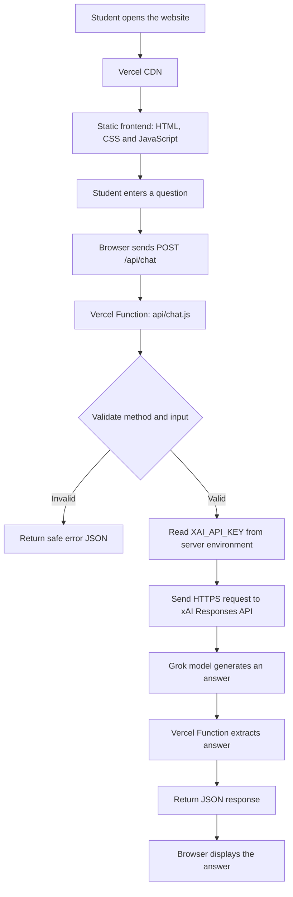
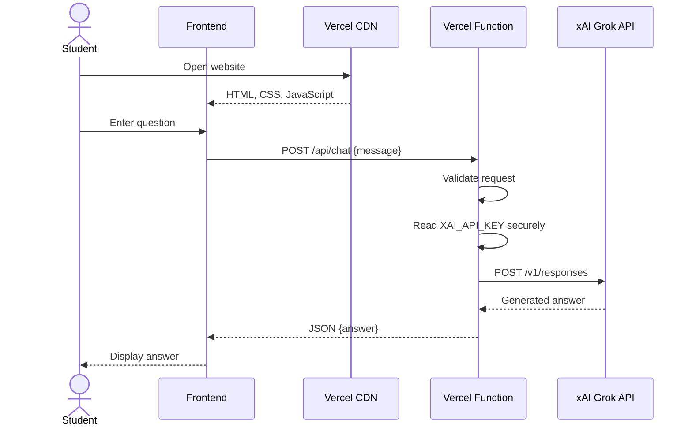

# FLOW.md — System Architecture and Workflow

## 1. Architecture diagram

## 2. Components and their responsibilities

| Component | Responsibility |
|---|---|
| Student / browser | Enters a question and reads the response. |
| Vercel CDN | Delivers static frontend files from its distributed network. |
| Frontend | Collects input, calls the backend route, and displays messages. |
| Vercel Function | Validates the request, protects the API key, and calls xAI. |
| xAI Grok API | Generates the answer using the selected Grok model. |
| Environment variable | Stores the secret API key outside the frontend source code. |

## 3. Step-by-step flow

1. The student opens the deployed website.
2. Vercel's CDN delivers the static HTML, CSS, and JavaScript files.
3. The student types a study-related question and presses Send.
4. The frontend sends the question to the same-origin endpoint `/api/chat` using an HTTP POST request.
5. The Vercel Function receives the request.
6. The function checks that the request uses POST, that the question is not empty, and that it is within the allowed character limit.
7. The function reads `XAI_API_KEY` from the server-side environment.
8. The function sends the question to the xAI Responses API over HTTPS.
9. Grok processes the question and generates a response.
10. The Vercel Function extracts the generated text and returns it as JSON.
11. The frontend displays the answer in the chat interface.
12. If an error occurs, the frontend displays a clear message and allows the student to try again.

## 4. Request and response sequence

## 5. Where cloud computing is used

- The frontend is deployed online rather than being available only on one computer.
- Vercel hosts the website and runs the backend function when a question is submitted.
- The xAI model is accessed as an online API; the project does not install or run the large AI model locally.
- The API key is stored in Vercel's environment-variable settings.

## 6. Where the CDN is used

Vercel's CDN serves the static website resources, such as HTML, CSS, and JavaScript, from a distributed network. A visitor can receive these assets from a nearby point of presence.

The CDN does not perform the Grok model's reasoning. The dynamic `/api/chat` request is handled by a Vercel Function, which communicates with xAI. The AI response should not be publicly cached because it depends on the individual question.

## 7. Expected outcome

The project demonstrates how cloud services and an external AI API can work together:

- Students can access the assistant through a web browser.
- Static frontend resources are distributed through a CDN.
- Backend logic runs as a serverless cloud function.
- Grok generates answers through an API request.
- The API key remains on the server rather than being exposed in the browser.

## 8. Important limitations

- The application needs an internet connection.
- Grok API access, model availability, rate limits, and usage costs depend on the xAI account.
- AI-generated answers can be incorrect or incomplete.
- A public deployment should include rate limiting and abuse protection.
- This prototype does not store chat history or provide user authentication.
